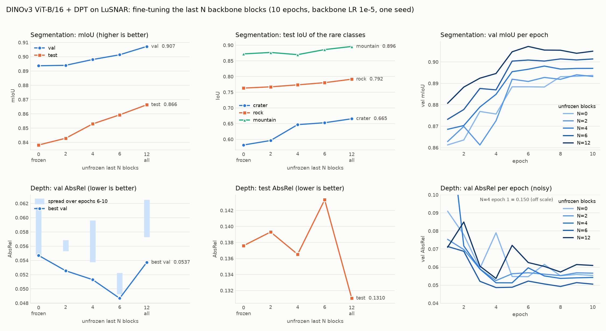
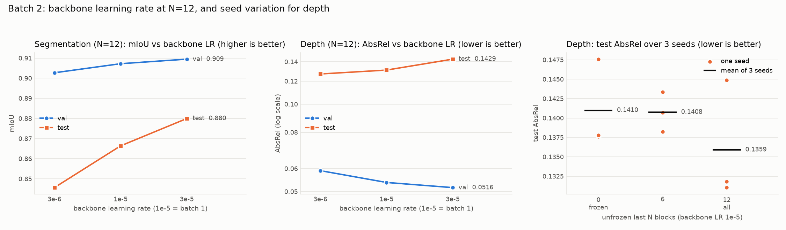

# Unfreezing the DINOv3 backbone (JIM)

Fine-tuning the last N blocks of DINOv3 ViT-B/16 for segmentation and depth, compared with the frozen baseline in
`dinov3_dpt_seg_depth.ipynb`. Everything else is identical to that baseline: DPT neck and heads, losses, training loop
and metrics are copied verbatim from the notebook; split val = Moon_8, test = Moon_3 + Moon_9; 512×512; batch 8;
10 epochs; head LR 2e-4; best checkpoint chosen on val. One model per task (no multitask).

## Files

| File | What |
|---|---|
| `train_unfreeze.py` | Training script. `--task seg\|depth --unfreeze N --backbone-lr LR --seed S --run-dir DIR` (`--unfreeze 0` = baseline). |
| `train_unfreeze.sbatch` | Slurm job for one L40S on Pelle: `sbatch -J seg_unf4 jim/train_unfreeze.sbatch seg 4 [extra args]`. Uses Andreas's venv (`activate_lusnar.sh`). |
| `plot_unfreeze.py` | Makes the two figures from `results/`: `python jim/plot_unfreeze.py jim/results` |
| `results/<run>/` | `summary.json` (final val + test metrics) and `history.csv` (per-epoch) for every run. Checkpoints stay on UPPMAX in `/proj/uppmax2026-1-299/jimcai/runs/`. |

Run names: `<task>_unf<N>[_lr<LR>][_s<seed>]`; no suffix = backbone LR 1e-5, seed 0.

## Results

Segmentation (test = Moon_3 + Moon_9):

| N unfrozen | backbone LR | val mIoU | test mIoU | test crater IoU | test rock IoU |
|---|---|---|---|---|---|
| 0 (baseline) | – | 0.894 | 0.838 | 0.582 | 0.763 |
| 2 | 1e-5 | 0.894 | 0.843 | 0.596 | 0.767 |
| 4 | 1e-5 | 0.898 | 0.853 | 0.647 | 0.774 |
| 6 | 1e-5 | 0.901 | 0.859 | 0.653 | 0.781 |
| 12 | 3e-6 | 0.903 | 0.846 | 0.602 | 0.773 |
| 12 | 1e-5 | 0.907 | 0.866 | 0.665 | 0.792 |
| 12 | 3e-5 | **0.909** | **0.880** | **0.702** | **0.800** |

Depth, test AbsRel (lower is better):

| N unfrozen | seed 0 | seed 1 | seed 2 | mean |
|---|---|---|---|---|
| 0 (baseline) | 0.138 | 0.148 | 0.138 | 0.141 |
| 2 | 0.139 | | | |
| 4 | 0.137 | | | |
| 6 | 0.143 | 0.141 | 0.138 | 0.141 |
| 12 | 0.131 | 0.145 | 0.132 | 0.136 |
| 12, LR 3e-6 | 0.127 | | | |
| 12, LR 3e-5 | 0.143 | | | |

- **Segmentation:** unfreezing helps, more blocks and a higher backbone LR help more; val and test agree. The rare classes gain most.
- **Depth:** no measurable gain; differences between N are within seed noise. Unfrozen models peak at epoch 4–5 and then overfit. A lower backbone LR does better on test, but val ranks the LRs the other way. Seed 1 converges worse for every N (train SILog ~0.09 vs ~0.06), so depth is sensitive to initialisation.

